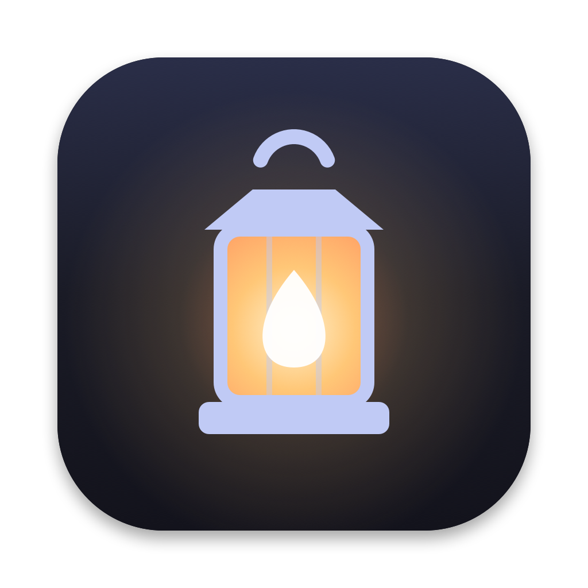
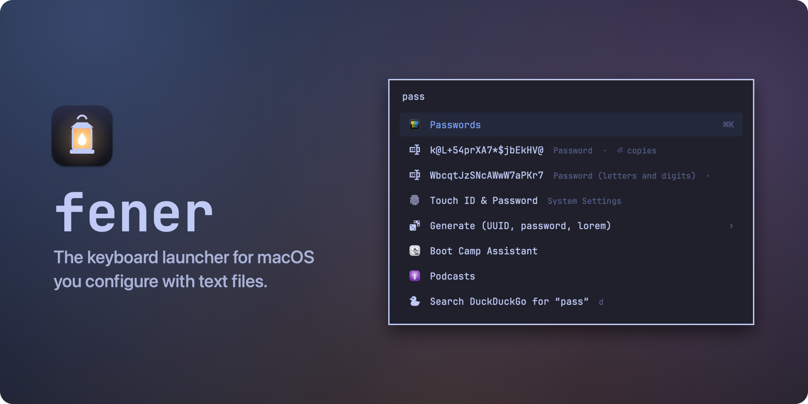
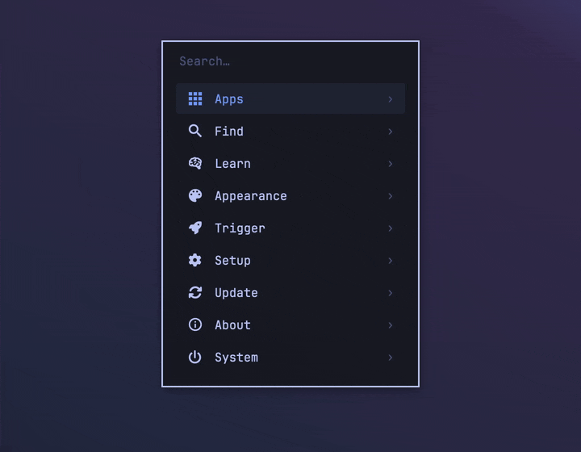
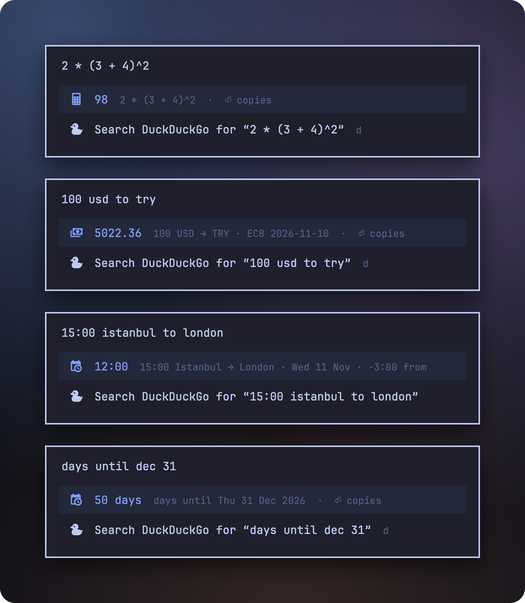
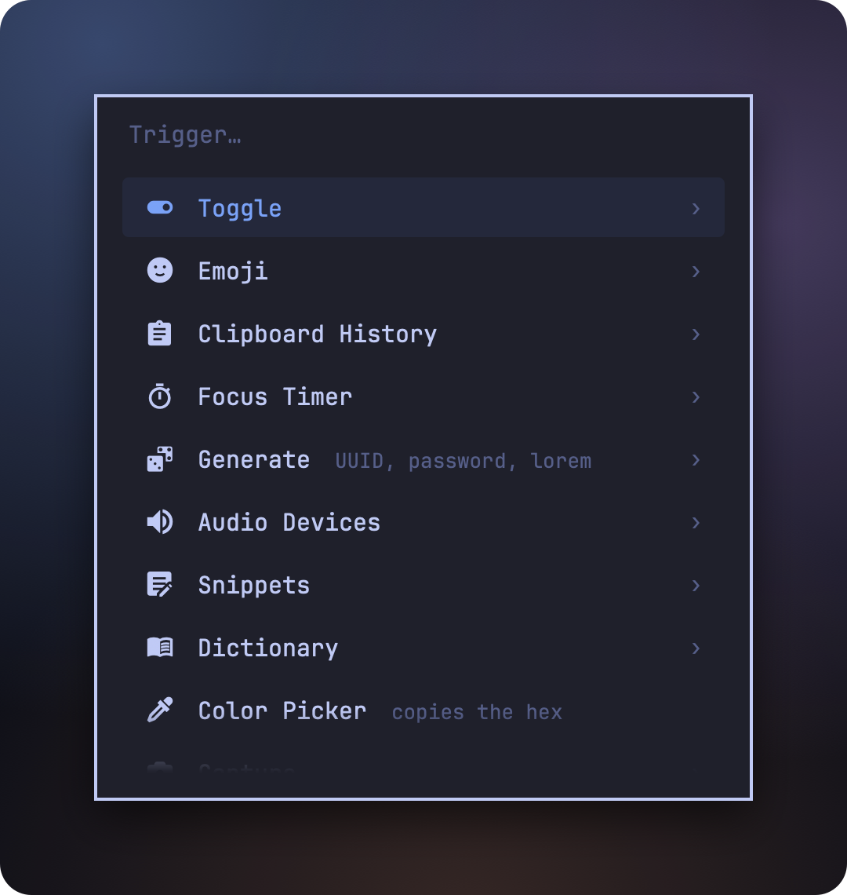
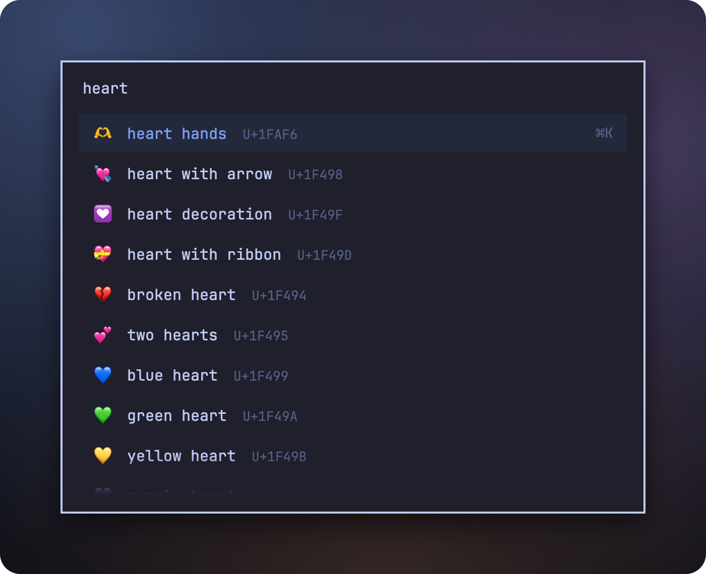
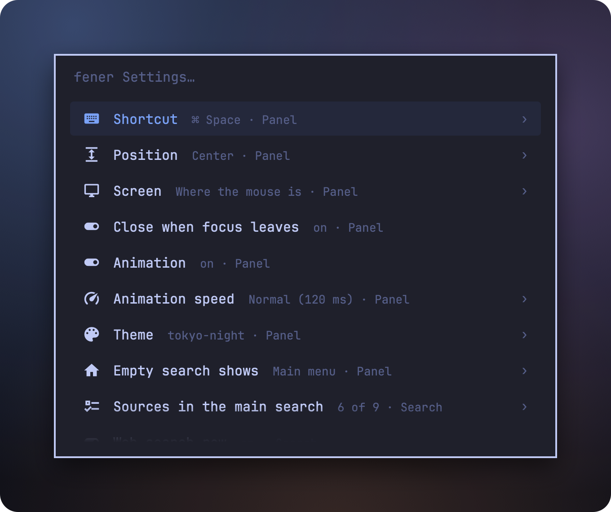

<div align="center">
  
  <h1>fener</h1>
  <p><b>The keyboard launcher for macOS you configure with text files.</b><br>
  Fast, private and native. Free and open source.</p>
  <p>
    <a href="https://github.com/omerdikyol/fener/releases/latest"><b>Download</b></a> ·
    <a href="#install">Install</a> ·
    <a href="#features">Features</a> ·
    <a href="docs/guide.md">Guide</a>
  </p>
  <p>
    <a href="https://github.com/omerdikyol/fener/releases/latest"></a>
    
    
    <a href="LICENSE"></a>
  </p>
</div>



One shortcut opens fener. Type to launch apps, find files, copy from your clipboard history,
pick an emoji, convert a currency or ask what time it is in Tokyo. Everything else, from the
theme to your own menus, is a text file in `~/.config/fener` that applies the moment you
save it.

*Fener* means lantern in Turkish.

<p align="center">
  
</p>

## Features

<table>
  <tr>
    <td width="50%" valign="top">
      
      <h3>Answers as you type</h3>
      Math, units, currencies with the ECB's daily rates, time zones and date math. Return copies the result.
    </td>
    <td width="50%" valign="top">
      
      <h3>Menus you write</h3>
      Any shell command becomes a menu entry, and any script that prints lines becomes a menu, with submenus, confirmations and live refresh.
    </td>
  </tr>
  <tr>
    <td width="50%" valign="top">
      
      <h3>Emoji, snippets and more</h3>
      Emoji and symbols with <code>:</code>, text snippets with placeholders, an offline dictionary, UUIDs and passwords.
    </td>
    <td width="50%" valign="top">
      
      <h3>Settings in the panel or in a file</h3>
      Change the shortcut, position, theme and sources in fener Settings, or edit <code>config.toml</code>. Both stay in sync.
    </td>
  </tr>
</table>

And also:

- **Apps** ranked by how often you open them. fener learns what you pick for what you type.
- **Files** through Spotlight, plus Recent Files and Screenshots with thumbnails.
- **Clipboard history** for text, files and images, encrypted on disk. Password managers' copies are skipped.
- **System actions**: lock, sleep, restart, empty Trash, switch audio devices, find what listens on a port, pick a color.
- **Bookmarks** from Chromium-based browsers, **projects** from VS Code-family editors, **web searches** with keywords (`gh swift toml`).
- **Windows** from the [OmniWM](https://omniwm.app) tiling window manager.
- **Themes**: Tokyo Night by default, Catppuccin Mocha included, or your own.

## Install

### Download

1. Download the latest `fener-<version>.zip` from [Releases](https://github.com/omerdikyol/fener/releases/latest), unzip it and move `fener.app` to Applications.
2. Open it. The panel appears, and fener adds itself to Login Items.
3. Press <kbd>⌘</kbd> <kbd>Space</kbd>. First turn off Spotlight's shortcut in System Settings › Keyboard › Keyboard Shortcuts › Spotlight, or pick another shortcut in fener Settings.

fener is signed and notarized, runs on Apple Silicon and Intel, and needs macOS 14 or later.
Icons use a [Nerd Font](https://www.nerdfonts.com): `brew install --cask font-jetbrains-mono-nerd-font`.

### Build from source

```sh
git clone https://github.com/omerdikyol/fener.git
cd fener && ./scripts/install.sh
```

This needs Xcode or the Command Line Tools. See the [guide](docs/guide.md#building-from-source) for details.

## Quick start

| Type | To |
| --- | --- |
| anything | search apps, menus, settings, snippets and more |
| `2 * (3 + 4)^2`, `10 km to mi`, `100 usd to try` | get an answer; <kbd>Return</kbd> copies it |
| `time in tokyo`, `days until dec 31` | ask about times and dates |
| `/` `:` `*` `!` `;` `>` | search only files, emoji, clipboard, snippets, windows or menus |
| `gh swift toml` | search the web with a keyword |

<kbd>⌘</kbd> <kbd>K</kbd> shows more actions for the selected row, <kbd>⌘</kbd> <kbd>1</kbd>–<kbd>9</kbd> runs a row, and <kbd>Esc</kbd> closes.
The [guide](docs/guide.md) covers keys, menus, snippets, themes and the command line.

## Make it yours

Settings live in `~/.config/fener/config.toml`, with every option and its default in
`config.reference.toml` next to it. A menu is a small TOML file:

```toml
# ~/.config/fener/menus/capture.toml
[[entry]]
name = "Screenshot of an area"
icon = "nf-md-crop"
command = "screencapture -ic"

[[entry]]
name = "Restart Dock"
command = "killall Dock"
confirm = true
```

Keep the folder in your dotfiles; fener applies changes as soon as you save.

## Private by design

- **No telemetry, no update checks, no account.** The only network request is the European Central Bank's public exchange-rate file, at most once a day, when you convert a currency.
- **Clipboard history is encrypted** with a key in your Keychain, never leaves your Mac, and can be turned off.
- **Few permissions.** fener needs no Accessibility, Input Monitoring or Screen Recording.

Details are in the [guide](docs/guide.md#privacy-and-permissions).

## How it compares

Every one of these is a good launcher. Here is how fener differs.

| | fener | Spotlight (macOS 26) | Raycast | Alfred |
| --- | --- | --- | --- | --- |
| Price | free | built in | free core; Pro subscription | free core; paid Powerpack |
| Source | open (MIT) | closed | closed app, open extensions | closed |
| Account | none | none | needed for cloud features | none |
| Network | ECB rates only | Apple services (suggestions) | yes | update checks |
| Configured with | TOML files and the panel | System Settings | the app's UI | the app's UI |
| Extend with | shell commands and scripts | Shortcuts, app actions | extension store (TypeScript) | workflows (Powerpack) |
| Clipboard history | yes, encrypted | yes | yes (longer with Pro) | Powerpack |
| Snippets | copy to paste | no | yes, auto-expand | Powerpack, auto-expand |
| Window switching | OmniWM only | no | yes | via workflows |
| AI features | no | Apple Intelligence | yes (Pro) | via workflows |
| Themes | TOML files | no | Pro | Powerpack |

**Choose fener** if you want a launcher you configure in text, keep in your dotfiles, read
the whole source of, and trust not to talk to the network.

**Choose something else** if you want a large catalog of ready-made extensions (Raycast or
Alfred), AI chat in the launcher (Raycast), snippets that expand as you type (Raycast or
Alfred), or nothing to install (Spotlight).

## FAQ

<details>
<summary><b>Pressing ⌘ Space opens Spotlight, not fener.</b></summary>

macOS gives ⌘ Space to Spotlight. Turn it off in System Settings › Keyboard › Keyboard Shortcuts › Spotlight, or choose another shortcut in fener Settings › Shortcut. fener lists the clash at the top of its panel until it is resolved.
</details>

<details>
<summary><b>Why doesn't picking a snippet type it for me?</b></summary>

Typing into other apps needs the Accessibility permission, which fener does without. Snippets are copied; paste them with <kbd>⌘</kbd> <kbd>V</kbd>.
</details>

<details>
<summary><b>Can I open fener from Karabiner, skhd or Hammerspoon?</b></summary>

Yes. Run `fener toggle` from any tool; `extras/karabiner-rule.json` maps Hyper+Space to it. See the [guide](docs/guide.md#opening-fener).
</details>

<details>
<summary><b>How do I uninstall it?</b></summary>

Choose System › Quit fener, remove it from Login Items and delete the app. If you built it from source, run `./scripts/uninstall.sh`. Your settings stay in `~/.config/fener` until you delete that folder.
</details>

## Limitations

- Snippets are copied, not typed (see the FAQ).
- Window switching needs OmniWM.
- Bookmarks come only from Chromium-based browsers.
- Tested on macOS 26 on Apple Silicon. macOS 14 and 15 and Intel Macs should work but are untested.

## License

MIT, see [LICENSE](LICENSE). fener is written from scratch; it takes ideas from [Omarchy](https://omarchy.org) and Walker but no code. Third-party data (Nerd Font glyph names, the Tokyo Night and Catppuccin palettes) is listed in [THIRD_PARTY_NOTICES.md](THIRD_PARTY_NOTICES.md).
