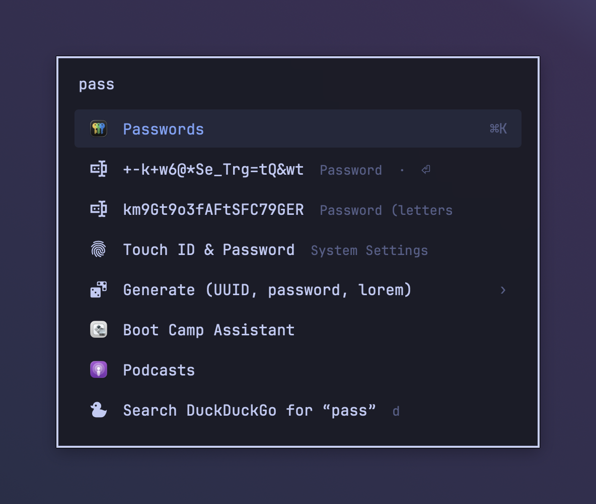
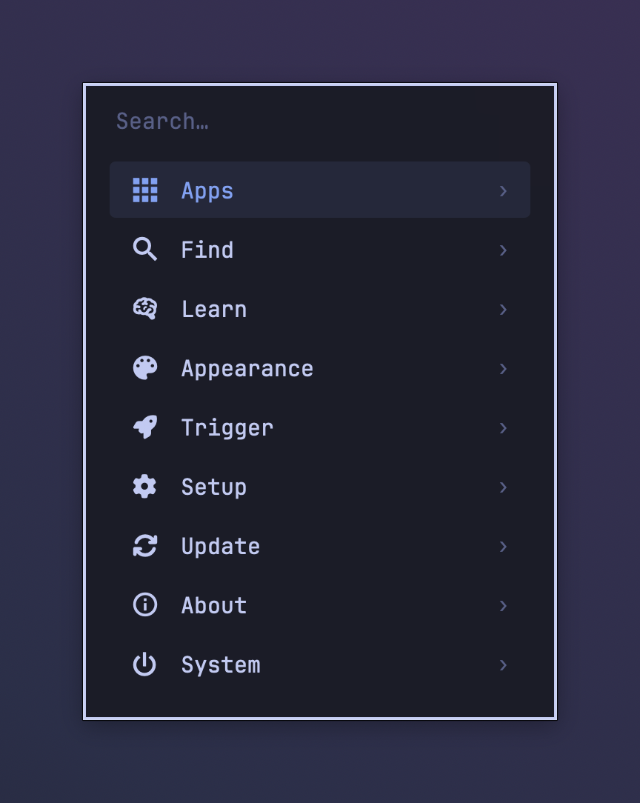
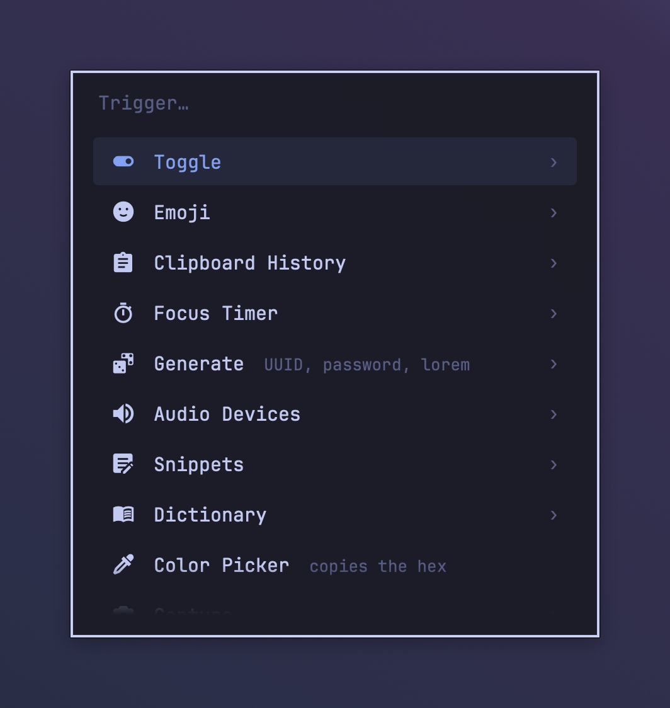
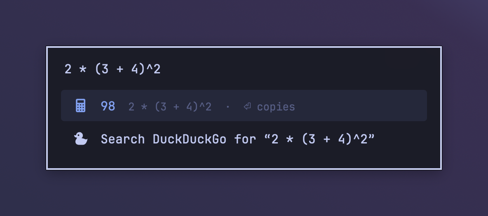
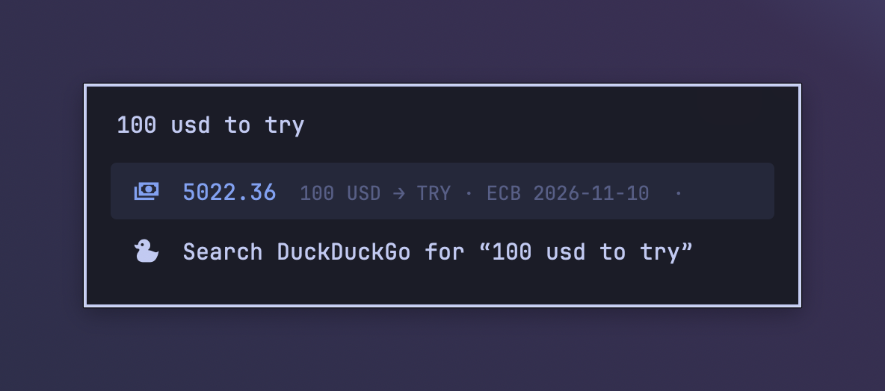
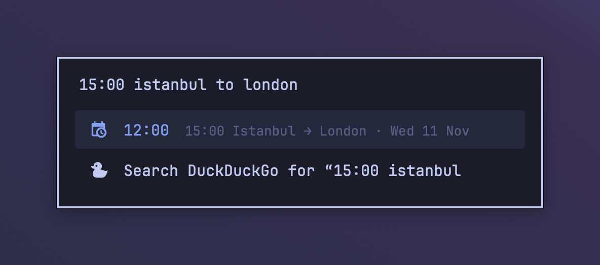
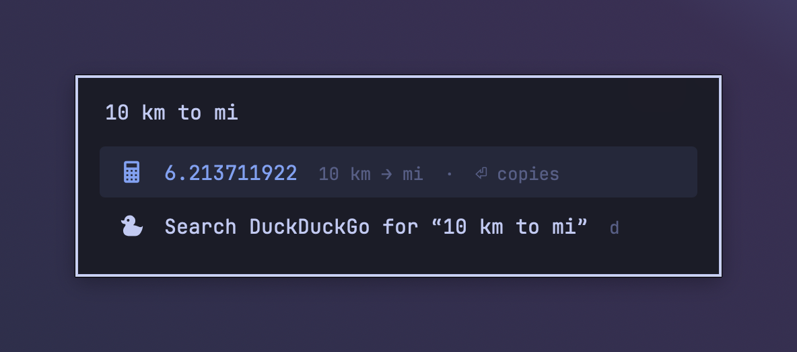
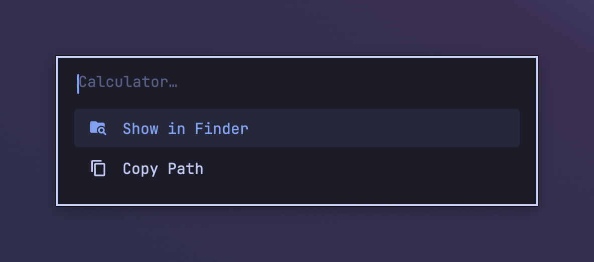

# fener

**A fast, private, keyboard-first launcher for macOS that you configure with text files.**

Native Swift and AppKit, no dependencies, no account, nothing sent over the network. One
shortcut opens a panel: search apps, files, emoji, clipboard history, snippets and System
Settings, get instant answers for sums, units, currencies and time zones, and build your own
menus out of shell commands. Inspired by the menus of [Omarchy](https://omarchy.org).

*Fener* is Turkish for lantern.



## Why fener

- **Quick.** About 30 ms from key press to panel on an Apple Silicon Mac. It is a resident
  native app with no web view.
- **Private.** No telemetry, no update checks, no account. The only network request is the
  European Central Bank's public exchange-rate file, and only when you convert a currency.
  Clipboard history is encrypted on disk.
- **Few permissions.** It works without Accessibility, Input Monitoring or Screen Recording.
- **Plain text.** Settings, menus, themes, snippets and web searches are TOML or shell
  scripts in `~/.config/fener`, easy to keep in your dotfiles. Changes apply when you save.
  Most settings can also be changed in the panel.
- **Yours to extend.** Any shell command can become a menu entry, and any script that
  prints lines can become a menu.
- **Small.** About 5,000 lines of Swift, MIT licensed. A clean release build takes about 15 seconds.

## Screenshots

| | |
| :---: | :---: |
|  |  |
| The main menu, listed while the search is empty | Emoji and symbols, with `:` |
|  |  |
| A menu from `menus/trigger.toml` | fener Settings, saved to `config.toml` |

Answers as you type:

| | |
| :---: | :---: |
|  |  |
|  |  |

Cmd+K shows more actions for the selected row:



## Features

- **Apps**, ranked by how often and how recently you open them. fener also learns which row
  you pick for what you type.
- **Files** through Spotlight, plus **Recent Files** and **Screenshots** views with thumbnails.
- **Clipboard history**: text, files and images, encrypted, with password-manager copies
  skipped.
- **Calculator and units**, **currency conversion** (ECB rates), and **time zones and date
  math** (`days until dec 31`).
- **Emoji and symbols**, **snippets** with placeholders, and an offline **dictionary**.
- **System**: lock, sleep, restart, empty Trash and more, plus System Settings panes, audio
  output and input switching, a process list (`:3000` finds what listens on a port), and a
  color picker.
- **Generators**: UUIDs, passwords and lorem ipsum.
- **Browser bookmarks** (Chromium-based browsers), **editor projects** (VS Code, Cursor,
  VSCodium, Windsurf) and **web searches** with keywords (`gh swift toml`).
- **Windows** from the [OmniWM](https://omniwm.app) tiling window manager.
- **Your own menus**: TOML files or scripts, with submenus, confirmations, terminal commands
  and live-refreshing entries.
- **Themes**: Tokyo Night by default, Catppuccin Mocha included, or your own colors, font
  and layout.

## Compared with other launchers

Every one of these is a good launcher. Here is how fener differs.

| | fener | Spotlight (macOS 26) | Raycast | Alfred |
| --- | --- | --- | --- | --- |
| Price | free | built in | free core; Pro subscription | free core; paid Powerpack |
| Source | open (MIT) | closed | closed app, open extensions | closed |
| Account | none | none | needed for cloud features | none |
| Network | ECB rates only | Apple services (suggestions) | yes | update checks |
| Configured with | TOML files and the panel | System Settings | the app's UI | the app's UI |
| Extend with | shell commands and scripts | Shortcuts, app actions | extension store (TypeScript) | workflows (Powerpack) |
| Clipboard history | yes, encrypted | yes | yes (longer with Pro) | Powerpack |
| Snippets | copy to paste | no | yes, auto-expand | Powerpack, auto-expand |
| Window switching | OmniWM only | no | yes | via workflows |
| AI features | no | Apple Intelligence | yes (Pro) | via workflows |
| Themes | TOML files | no | Pro | Powerpack |

**Choose fener** if you want a launcher you configure in text, keep in your dotfiles, read
the whole source of, and trust not to talk to the network.

**Choose something else** if you want a large catalog of ready-made extensions (Raycast or
Alfred), AI chat in the launcher (Raycast), snippets that expand as you type (Raycast or
Alfred), or nothing to install (Spotlight).

## Install

fener needs macOS 14 or later and a [Nerd Font](https://www.nerdfonts.com) for its icons. The
default theme uses JetBrainsMono Nerd Font (`brew install --cask font-jetbrains-mono-nerd-font`);
a theme can set another.

### Download

1. Download `fener-<version>.zip` from [Releases](https://github.com/omerdikyol/fener/releases),
   unzip it and move `fener.app` to Applications. It is signed and notarized by Apple, and
   runs on Apple Silicon and Intel.
2. Open it. The panel appears, and fener adds itself to Login Items (System Settings ›
   General › Login Items) so it starts when you log in.
3. Optionally, put the `fener` command on your PATH:

   ```sh
   mkdir -p ~/.local/bin && ln -sf /Applications/fener.app/Contents/MacOS/fener ~/.local/bin/fener
   ```

Opening fener.app again shows the panel. To remove it, choose System › Quit fener, turn it
off in Login Items and delete the app.

### Build from source

You need the Swift toolchain (Xcode, or the Command Line Tools: `xcode-select --install`).

```sh
git clone https://github.com/omerdikyol/fener.git
cd fener
./scripts/install.sh
```

The script builds `fener.app` into `~/Applications`, links the `fener` command to
`~/.local/bin/fener`, and starts it as a LaunchAgent (`io.github.omerdikyol.fener`), so it
runs at login and restarts if it crashes. Run it again to update.

If you have a code-signing certificate (an Apple developer account's "Developer ID
Application" or "Apple Development"), the script signs the app with it, and macOS keeps
recognizing fener after you rebuild: the Keychain and privacy permissions do not ask again.
Set `FENER_SIGN_IDENTITY` to choose one. Without a certificate the app is signed ad hoc and
macOS treats every rebuild as a new app. `./scripts/uninstall.sh` stops and removes it and leaves your
config alone.

On its first start fener creates `~/.config/fener/config.toml` with every default. To start
from the example menus, themes and snippets too (existing files are not overwritten):

```sh
mkdir -p ~/.config/fener
rsync -a --ignore-existing extras/menus extras/themes extras/snippets extras/quicklinks.toml ~/.config/fener/
```

Some example menus call tools you may not have (`omniwmctl` for OmniWM, `sketchybar`); they
say so in the menu instead of failing. Without a `menus/menu.toml`, the empty search lists
your apps.

### A key to open it

The default shortcut is Cmd+Space. macOS gives Cmd+Space to Spotlight, so turn Spotlight's
off first: System Settings › Keyboard › Keyboard Shortcuts › Spotlight › Show Spotlight
search. Until then Spotlight keeps the key, and fener lists the clash at the top of its
panel (open it with `~/.local/bin/fener toggle`).

To use other keys, open fener Settings › Shortcut (`fener show preferences`) and press them,
or write them in `config.toml`:

```toml
shortcut = "shift+cmd+space"
```

It needs Command or Control, or an F-key, since Option and Shift alone type characters on
many layouts. fener registers it as a system hotkey, which needs no Input Monitoring or
Accessibility permission. A shortcut another app already uses is reported in the panel.

You can also leave `shortcut` empty and run `~/.local/bin/fener toggle` from any tool that
can run a shell command. With [Karabiner-Elements](https://karabiner-elements.pqrs.org),
`extras/karabiner-rule.json` maps Hyper+Space (Control+Option+Command+Space, for example
Caps Lock remapped to Hyper) to that command. Add it under Complex Modifications, or paste
it into the `rules` array of `~/.config/karabiner/karabiner.json`. skhd, Hammerspoon or
BetterTouchTool work the same way.

## Using it

| Key | Does |
| --- | --- |
| Return | run the selected row |
| Up / Down, Ctrl+N / Ctrl+P, Ctrl+J / Ctrl+K | move |
| Cmd+1 … Cmd+9 | run row 1–9 |
| Cmd+K | more actions for the selected row (Show in Finder, Quick Look, Copy Path, Edit, Quit, …) |
| Cmd+Return | the first of those actions |
| Backspace on an empty search | back to the previous menu |
| Escape | close |

The main search ranks apps, menus, system actions, snippets, System Settings panes, recent
editor projects, generators, browser bookmarks and open windows together. It learns which
row you pick for what you type, so `g` soon means the app you open with `g`. A web search
row is always last.

Start with a prefix to search one thing (change them in `[prefixes]`):

| Prefix | Searches |
| --- | --- |
| `=` | calculator |
| `/` | files (Spotlight, under your home folder) |
| `:` | emoji and symbols |
| `*` | clipboard history |
| `>` | your menus |
| `;` | open windows (OmniWM) |
| `!` | snippets |

Answers appear as you type, with no prefix needed:

```
2 * (3 + 4)^2         10 km to mi          72 f in c          1.5 gib to mb
100 usd to try        €50 in gbp
time in tokyo         15:00 istanbul to london
days until dec 31     today + 30 days      2026-12-24 + 1 month
```

`g fener`, `gh swift toml` and other `<keyword> <text>` searches open in your browser; add
your own in `quicklinks.toml`.

### Command line

```
fener toggle               show or hide the panel
fener show <menu> [text]   open a menu or built-in view (or "search"), optionally with text typed
fener hide
fener reload               re-read config, menus, themes and apps
fener pick-color           pick a color on screen; copies its hex value
fener query [@view] text   print what a search lists (for scripts and tests)
fener config [defaults]    show the config files, or print every default
fener log [-f]             show (or follow) the log
fener ping                 exit 0 if fener is running
```

Built-in views for `fener show` and for menu entries: `apps`, `files`, `recent`,
`screenshots`, `clipboard`, `emoji`, `snippets`, `windows`, `calc`, `dictionary`,
`system`, `quit`, `settings` (System Settings panes), `audio`, `bookmarks`, `projects`,
`generate`, `processes`, `used` (recently picked) and `preferences` (fener's own settings).

## Configuration

Everything lives in `~/.config/fener/` and applies as soon as you save a file:

```
config.toml             your settings
config.reference.toml   every option with its default and a comment (rewritten on start, never read)
quicklinks.toml         web search keywords and the default engine
themes/<name>.toml      colors, font and layout; select with theme = "<name>"
menus/<name>.toml       your menus
menus/<name>[.sh]       menus generated by a script
snippets/<name>.txt     text snippets
```

Most settings can also be changed from the panel: Setup › fener Settings, or
`fener show preferences`. Those changes are written to `config.toml` with your comments
kept. Mistakes are listed at the top of the empty search and in `fener log`, with the line
number. A wrong value or unknown key is skipped and the rest of the file applies; a file that
is not valid TOML is ignored (built-in defaults are used) until it is fixed.

### Menus

A menu is a TOML file of entries:

```toml
prompt = "Capture…"
width = 320                       # optional panel width

[[entry]]
name = "Screenshot of an area"
icon = "nf-md-crop"               # Nerd Font glyph name, SF Symbol, or an app or image path
command = "screencapture -ic"     # run with /bin/sh -c

[[entry]]
name = "Logs"
command = "tail -f /var/log/system.log"
terminal = true                   # run in a terminal window (terminal_command in config.toml)

[[entry]]
name = "Restart Dock"
command = "killall Dock"
confirm = true                    # ask first

[[entry]]
name = "Themes"
menu = "theme"                    # open another menu or a built-in view
```

A menu can also be an executable file. Run with no arguments, it prints its entries, one per
line, as plain names or JSON objects such as
`{"name": "Dark Mode: On", "value": "dark", "icon": "nf-md-theme_light_dark"}` (or one JSON
array). fener runs it again with the chosen entry's `value` (or name) as `$1`. A line
`{"refresh": 2}` makes fener re-run it every 2 seconds while it is open.
`extras/menus/toggle.sh` is a small example.

### Snippets

One file per snippet in `snippets/`, named after the file. Picking one copies its text with
these filled in: `{clipboard}`, `{uuid}`, `{date}`, `{time}`, `{datetime}` and
`{date:<pattern>}` (a `DateFormatter` pattern such as `{date:EEE d MMM}`). Paste it with
Cmd+V; fener does not type for you, because that needs the Accessibility permission.

### Themes

Copy `extras/themes/tokyo-night.toml` to `themes/<name>.toml`, change what you like
(colors, opacity, font, width, row height, corner radius, how many rows show) and set
`theme = "<name>"`. Catppuccin Mocha is included as a second example.

## Privacy and permissions

- **Network:** none, except one file. When you type a currency conversion and the cached
  rates are over a day old, fener downloads the European Central Bank's public daily
  reference rates. `[currency] enabled = false` turns that off. There is no telemetry and no
  update check. Quicklinks and web search rows open your browser; fener sends nothing itself.
- **Clipboard history** is stored encrypted (AES-GCM) in
  `~/Library/Application Support/fener/clipboard`, with a random key in your login
  Keychain, readable only by your user and excluded from backups. Copies that password
  managers mark as concealed or transient are never recorded, nor anything copied while an
  app in `[clipboard] ignore_apps` is in front. Items older than `keep_days` are deleted.
  `[clipboard] enabled = false` turns it off.
- **Learning** (which row you picked for which text, and the last 10 picks) stays in
  `~/Library/Application Support/fener/learned.json`. System › Forget Search History clears
  it; `learn_queries = false` turns it off. Keystrokes and abandoned searches are never
  recorded.
- **The log** (`~/Library/Logs/fener/fener.log`) records events and errors, never what you
  type or copy.

fener asks for no permissions up front and does not need Accessibility, Input Monitoring or
Screen Recording. macOS may ask once for:

- Keychain access, when the clipboard key is first read; choose Always Allow. If the app is
  signed ad hoc (no certificate), macOS asks again after each rebuild.
- Automation of System Events or Finder, the first time you use Restart, Shut Down, Log Out
  or Empty Trash.

## Limitations

- Snippets are copied for you to paste, not typed, which would need Accessibility.
- Window switching needs OmniWM. Some windows have no title there (`docs/known-issues.md`).
- Bookmarks come only from Chromium-based browsers.
- Tested on macOS 26 on Apple Silicon. macOS 14 and 15 and Intel Macs should work but are untested.

## Development

```sh
swift build
swift test
swift run fener --show --demo   # a second copy for testing; quit the installed one first
swift run -c release fener --bench   # scan and search timings
```

Sources are in `Sources/Fener`, one file per feature. See `docs/known-issues.md` for known
problems.

## License

MIT, see [LICENSE](LICENSE). fener is written from scratch; it takes ideas from Omarchy and
Walker but no code or theme files. Bundled third-party data (Nerd Font glyph names, the
Tokyo Night and Catppuccin palettes) is listed in
[THIRD_PARTY_NOTICES.md](THIRD_PARTY_NOTICES.md).
